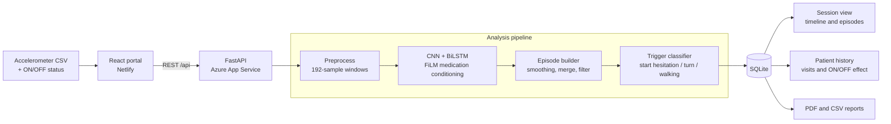

# Parkinson's Insight: FoG Track

GaitSense is a clinical research portal for reviewing Freezing of Gait (FoG) in Parkinson's disease gait recordings. This BS Computer Science final year project was developed at Bahria University Karachi in 2026.

## Live demo

- Frontend: https://gaitsense-fogtrack.netlify.app
- API: https://fogtrack-backend-gsb2ezcwdehscee6.centralindia-01.azurewebsites.net
- Health: https://fogtrack-backend-gsb2ezcwdehscee6.centralindia-01.azurewebsites.net/api/health
- Docs: https://fogtrack-backend-gsb2ezcwdehscee6.centralindia-01.azurewebsites.net/docs

## Why this project

- Freezing of gait is episodic and rarely seen in a short clinic visit.
- Most FoG detectors only give a yes/no result per window.
- This portal adds episodes, trigger types, ON/OFF medication context, and a longitudinal visit view.

## Features

- Upload tri-axial accelerometer CSV recordings with medication status.
- Detect FoG windows and merge them into episodes.
- Classify triggers as start hesitation, turn, or walking.
- Review longitudinal visits, subject progression, and population statistics.
- Annotate episodes and export PDF reports and CSV results.

## Architecture



Pipeline: Upload -> Preprocess -> Detect -> Build episodes -> Classify trigger -> Store -> Review and report.

## Tech stack

React, FastAPI, SQLite with SQLAlchemy, PyTorch, Plotly, and ReportLab; frontend on Netlify; backend on Azure App Service (Linux, Python 3.11).

## Results

| Model / task | Accuracy | FoG F1 |
|---|---:|---:|
| XGBoost | 0.90 | 0.88 |
| CNN + BiLSTM | 0.92 | 0.91 |
| Medication-conditioned CNN + BiLSTM | 0.94 | 0.93 |
| Trigger classification | — | Macro F1 about 0.67; Walking F1 about 0.52 |

## Design decisions

### FiLM medication conditioning

ON/OFF status modulates the convolutional feature maps so one model handles both states instead of two separate models.

### Lowered decision threshold (0.42, tuned on the validation set)

This trades a little precision for higher recall because missed freezing episodes matter more clinically.

### Causal smoothing (k=7) plus episode merging and minimum-duration filtering

This removes isolated false positives and turns window predictions into clinically meaningful episodes; the causal filter uses no future windows.

## Project structure

```text
.
├── anticipation_research/       # FoG anticipation pipeline
├── clinical_portal/
│   ├── backend/
│   │   ├── data/                # Portal metadata
│   │   ├── db/                  # SQLAlchemy setup
│   │   ├── models/              # Architectures and model loader
│   │   ├── model_weights/       # Portal inference weights
│   │   ├── routers/             # API routes
│   │   └── services/            # Inference, parsing, CRUD, and reports
│   ├── frontend/                # React portal
│   └── README.md
├── dataset/                    # Local raw-data workspace
├── experiments/
│   ├── data_preprocessing/
│   ├── exploratory_analysis/
│   ├── model_training/
│   └── trigger_prediction/
├── results/
├── trained_models/
└── README.md
```

## Running locally

See [clinical_portal/README.md](clinical_portal/README.md) for backend and frontend setup instructions.

## Deployment

See [docs/DEPLOYMENT.md](docs/DEPLOYMENT.md) for Azure App Service and Netlify deployment instructions.

## Dataset

The project uses the public Kaggle tDCS FOG dataset, which is anonymized. Raw data is not included in the repository; obtain it separately and follow the notebook path notes.

## Limitations

- Trained and evaluated on a public dataset, not validated on real-world clinical data.
- ON/OFF medication is binary and cannot capture wearing-off.
- Trigger classification is limited by class imbalance (Walking F1 about 0.52).
- Offline session-based analysis only, no real-time streaming.
- The demo site has no login.

## Authors

- Laiba Ali
- Kishmala Khan
- Atifa Nawaz

Supervisor: Mr. Malik M Ali

## Disclaimer

This is a research tool, not a diagnostic device. It is not a substitute for clinical judgment and should not be used as the sole basis for diagnosis or treatment.

## TODO for me

- Add screenshots.
- Add a LICENSE.
