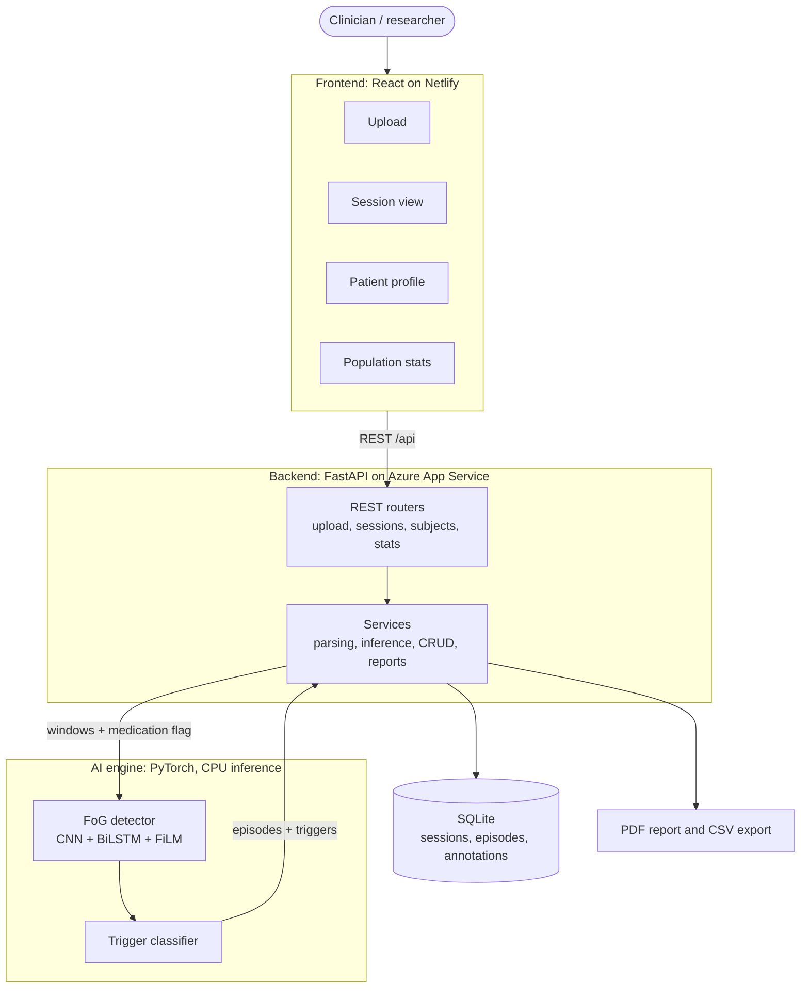
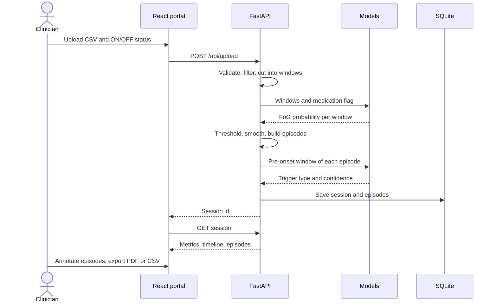
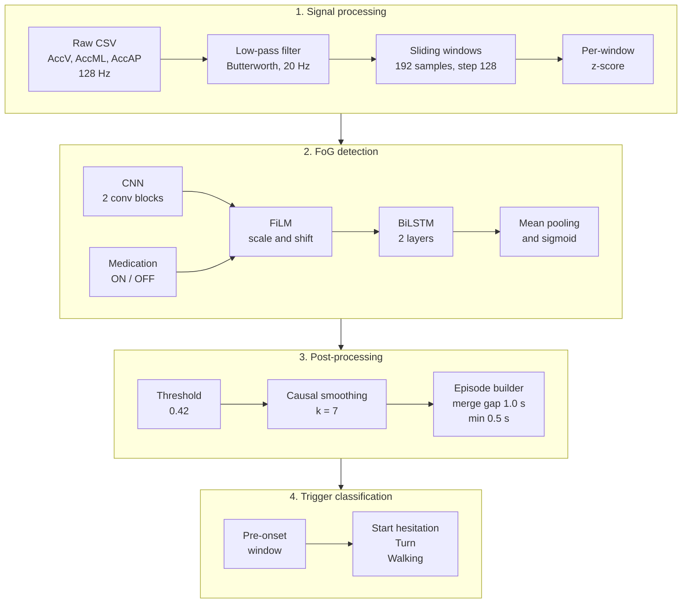
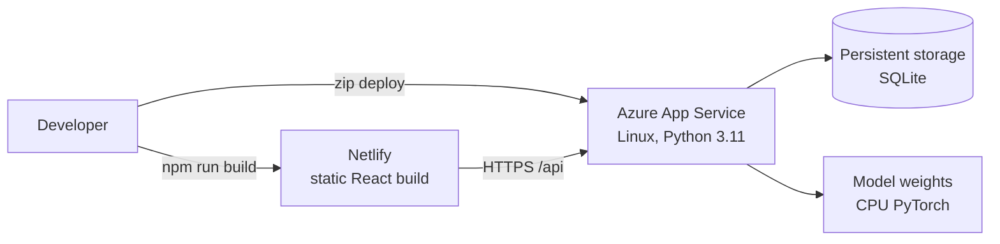

<div align="center">

# Parkinson's Insight: FoG Track

**An end-to-end clinical decision-support portal for detecting, classifying and tracking Freezing of Gait in Parkinson's disease from a single wearable accelerometer.**


[Live demo](https://gaitsense-fogtrack.netlify.app) | [Architecture](#system-architecture) | [Results](#results) | [Getting started](#getting-started)

</div>

---

## Overview

Freezing of Gait (FoG) is one of the most disabling symptoms of Parkinson's disease: patients suddenly cannot start or continue walking. Episodes are short, unpredictable and rarely appear during a brief clinic visit, so clinicians depend on diaries and short observations that are subjective and incomplete.

**GaitSense** (the portal of *Parkinson's Insight: FoG Track*) turns a raw wearable recording into structured, interpretable clinical information:

- **Detects** every freezing episode with start time, end time and duration
- **Classifies** each episode by trigger: start hesitation, turning, or walking
- **Conditions on medication** (ON or OFF) so one model handles both states
- **Tracks patients over time** across visits to show progression and medication effect
- **Reports** results as a PDF and CSV, with clinician annotation of every episode

This is a BS Computer Science final year project at Bahria University Karachi (2026).

## Live demo

**https://gaitsense-fogtrack.netlify.app**

The demo has no login. Please upload only public tDCS FOG recordings. The first request after the server has been idle may be slow.

## Highlights

| | |
|---|---|
| **0.94** accuracy, **0.93** FoG F1 | Medication-conditioned CNN + BiLSTM, evaluated on subjects unseen during training |
| **1** wearable sensor | Tri-axial accelerometer at 128 Hz (AccV, AccML, AccAP) |
| **3** trigger types | Start hesitation, turn, walking |
| **4** model families compared | Logistic Regression, Random Forest, SVM, XGBoost, then CNN + BiLSTM |
| **Explainable** | Integrated Gradients attribution across 100 correctly detected episodes |
| **Deployed** | React on Netlify, FastAPI on Azure App Service |

## Features

- **Upload and analyse** a CSV recording with a medication status, with validation and clear errors
- **Session view**: FoG probability timeline, colour-coded episodes, summary metrics (episode count, total freezing time, burden, average and maximum duration)
- **Clinician annotation**: mark each episode as confirmed, uncertain, or artifact; low-confidence predictions are flagged
- **Patient profile**: visit history, FoG burden across visits, trigger mix, and ON versus OFF medication effect
- **Population statistics**: burden distribution, trigger distribution and medication effect across all stored sessions
- **Exports**: PDF clinical report and CSV of detected episodes

## System architecture



## What happens when you upload a recording



## Model pipeline



**Why these choices**

- **FiLM medication conditioning.** ON or OFF status scales and shifts the convolutional feature maps, so one model handles both states instead of two separate models. It adds about 12,000 parameters, under 2% of the model.
- **Threshold 0.42.** Tuned on the validation set. It trades a little precision for higher recall, because a missed freezing episode matters more clinically than a false alarm.
- **Causal smoothing and episode building.** Isolated false positives are removed and window predictions become clinical episodes. The smoothing filter uses no future windows.
- **Subject-independent evaluation.** Training, validation and test sets are split by subject, so every score is measured on people the model has never seen.

## Results

### FoG detection

| Model | Accuracy | Precision (FoG) | Recall (FoG) | F1 (FoG) |
|---|---:|---:|---:|---:|
| Logistic Regression | 0.81 | 0.72 | 0.90 | 0.80 |
| Random Forest | 0.88 | 0.92 | 0.78 | 0.84 |
| SVM (RBF) | 0.80 | 0.94 | 0.54 | 0.69 |
| XGBoost | 0.90 | 0.86 | 0.90 | 0.88 |
| CNN + BiLSTM | 0.92 | 0.91 | 0.90 | 0.91 |
| **Medication-conditioned CNN + BiLSTM** | **0.94** | **0.96** | **0.90** | **0.93** |

The classical models use hand-engineered frequency features: band energies and the Freeze Index. The deep models learn directly from the raw signal.

### Trigger classification

| Class | Random Forest F1 | CNN + BiLSTM F1 |
|---|---:|---:|
| Start hesitation | about 0.59 | about 0.57 |
| Turn | about 0.93 | about 0.92 |
| Walking | about 0.00 | about 0.52 |
| **Macro F1** | **about 0.50** | **about 0.67** |

The data is small (about 979 pre-onset windows) and about 83% of it is turning, so Walking is the weakest class.

### Explainability

Integrated Gradients (Captum) were computed on 100 correctly detected FoG windows. The model relies most on the last 0.3 to 0.5 seconds of each window, where the freeze is fully developed. By axis, vertical (AccV) carries 39.2% of the attribution, mediolateral 30.8% and anteroposterior 30.0%, so no axis can be dropped. Missed episodes look the same to the model as detected ones, only weaker, which points to signal strength rather than a different decision strategy.

## Portal pages

| Page | What it shows |
|---|---|
| Dashboard | Entry point and summary |
| New upload | CSV upload, medication status, optional clinical note |
| Patients | All subjects with visits, last visit and colour-coded FoG burden |
| Patient profile | Visit history, burden trend, trigger mix, ON versus OFF effect |
| Session view | Probability timeline, episodes, trigger probabilities, annotation, exports |
| Population stats | Burden histogram, trigger distribution, medication effect |

<!--
Add screenshots here when ready, for example:

-->

## Tech stack

| Layer | Technology |
|---|---|
| Frontend | React, React Router, Axios, Plotly |
| Backend | FastAPI, Pydantic, SQLAlchemy |
| Database | SQLite |
| ML and DL | PyTorch, scikit-learn, XGBoost, Captum |
| Reports | ReportLab |
| Hosting | Netlify (frontend), Azure App Service on Linux with Python 3.11 (backend) |

## API

| Method | Route | Purpose |
|---|---|---|
| GET | `/api/health` | Service and model status |
| POST | `/api/upload` | Upload a CSV and run the analysis |
| GET | `/api/sessions/{session_id}` | Session metrics, timeline and episodes |
| PATCH | `/api/sessions/{session_id}/episodes/{episode_id}/annotate` | Annotate an episode |
| GET | `/api/sessions/{session_id}/report` | PDF report |
| GET | `/api/sessions/{session_id}/export-csv` | Episodes as CSV |
| GET | `/api/subjects/` | List subjects |
| GET | `/api/subjects/{subject_id}` | Subject profile and visits |
| GET | `/api/subjects/{subject_id}/progression` | Longitudinal progression |
| GET | `/api/subjects/{subject_id}/report` | Subject PDF report |
| GET | `/api/stats/` | Population statistics |

## Getting started

Full instructions are in [clinical_portal/README.md](clinical_portal/README.md). In short, on Windows PowerShell:

```powershell
# Backend
cd clinical_portal
python -m venv venv
.\venv\Scripts\Activate.ps1
python -m pip install -r backend\requirements.txt
$env:PYTHONUTF8 = "1"
python -m uvicorn backend.main:app --port 8000
```

```powershell
# Frontend, in a second terminal
cd clinical_portal\frontend
npm install
npm start
```

Open http://localhost:3000.

## Deployment



Step-by-step instructions, app settings and troubleshooting are in [docs/DEPLOYMENT.md](docs/DEPLOYMENT.md).

## Project structure

```text
.
|-- anticipation_research/       # FoG anticipation pipeline
|-- clinical_portal/
|   |-- backend/
|   |   |-- data/                # Portal metadata
|   |   |-- db/                  # SQLAlchemy setup
|   |   |-- models/              # Architectures and model loader
|   |   |-- model_weights/       # Portal inference weights
|   |   |-- routers/             # API routes
|   |   `-- services/            # Inference, parsing, CRUD, reports
|   |-- frontend/                # React portal
|   `-- README.md
|-- dataset/                     # Metadata only; raw recordings are not included
|-- docs/                        # Deployment guide
|-- experiments/
|   |-- data_preprocessing/
|   |-- exploratory_analysis/
|   |-- model_training/
|   `-- trigger_prediction/
|-- results/
|-- trained_models/
`-- README.md
```

## Dataset

The models were trained and evaluated on the public, anonymized Kaggle tDCS FOG dataset (833 recordings at 128 Hz). Raw recordings are not included in this repository; download them separately and see [experiments/README.md](experiments/README.md) for the paths the notebooks expect. No new patient data was collected.

## Limitations and future work

**Limitations**

- Trained and evaluated on a public dataset, not validated on real-world clinical data
- ON/OFF medication is binary and cannot capture wearing-off
- Trigger classification is limited by class imbalance (Walking F1 about 0.52)
- Offline, session-based analysis only; no real-time streaming
- The demo site has no login

**Future work**

- Prospective clinical validation with a neurology department
- Real-time inference on edge devices such as wrist or ankle wearables, with cueing feedback
- More trigger data for the rare classes, with augmentation such as time warping and noise
- Transformer-based architectures for FoG detection

## Authors

**Laiba Ali | Kishmala Khan | Atifa Nawaz**

Supervisor: Mr. Malik M Ali, Department of Computer Science, Bahria University Karachi

## Disclaimer

This is a research tool and not a diagnostic device. It is not a substitute for clinical judgment and must not be used as the sole basis for diagnosis or treatment.
